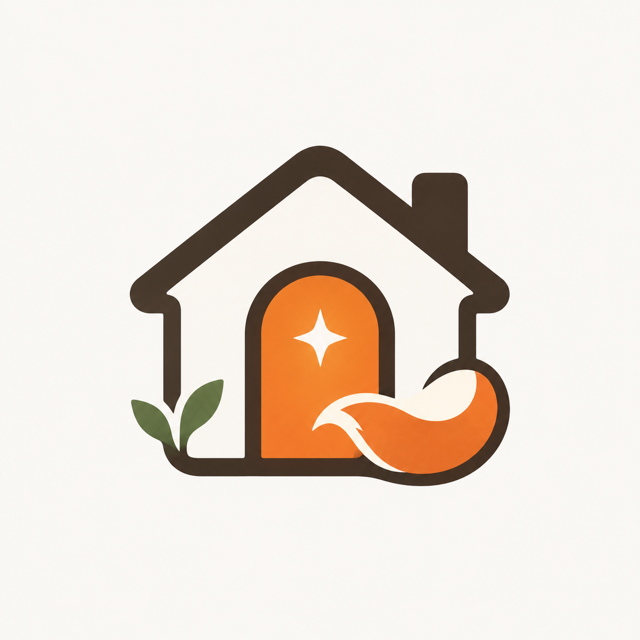

  

# AI Cottage Painter · AI 小屋粉刷匠

**Make a little home with your AI.** 
和你的 AI，一起布置一间小屋。

[Try it online](https://omnitopia.space/tools/ai-cottage-painter/) · [中文说明](#中文)

## What it does

AI Cottage Painter is a tiny bilingual web tool for personalizing ChatGPT Intelligent UI conversations. Choose a shared symbol, a color theme, and a few personal touches, preview the result, then copy a decorating note into ChatGPT.

It is a single static HTML file with no account, server, analytics, or build step. Your names and choices stay in your browser's local storage.

## Features

- Six color themes inspired by nature and the Omnitopia family palette
- Shared-symbol picker and eight optional personal touches
- Live chat preview
- Chinese and English interface
- One-click decorating-note copy on the web
- Responsive layout for desktop and mobile
- Blank public defaults with no personal names prefilled

## Use locally

Download the repository and open `index.html` in a browser. You can also publish the same file with GitHub Pages, Cloudflare Pages, or any static host.

## About Intelligent UI

The generated note describes a visual preference for suitable ChatGPT replies. ChatGPT still decides how each response should be rendered, so the exact layout may vary and the tool does not permanently modify the native app interface.

## 中文

AI 小屋粉刷匠是一款中英双语的静态网页工具。你可以选择关系符号、主题色和个性化小机关，实时预览聊天小屋，再生成一份适用于 ChatGPT Intelligent UI 的装修手札。

整个工具只有一个 HTML 文件，不需要账号、服务器、统计服务或构建环境。填写的名字和选项只保存在当前浏览器的本地存储中。

### 主要功能

- 六组来自自然与 Omnitopia 全家色卡的主题色
- 多种关系符号与八个可选小机关
- 实时聊天预览
- 中英文整页切换
- 网页版一键复制装修手札
- 适配桌面与手机屏幕
- 公开默认信息为空，不预填真实姓名

### 本地使用

下载仓库后，直接用浏览器打开 `index.html` 即可。也可以部署到 GitHub Pages、Cloudflare Pages 或任何静态网站托管服务。

## Credits

Created with love by Folia & Omni at [Omnitopia](https://omnitopia.space/).

Every home has its own story. ✦
